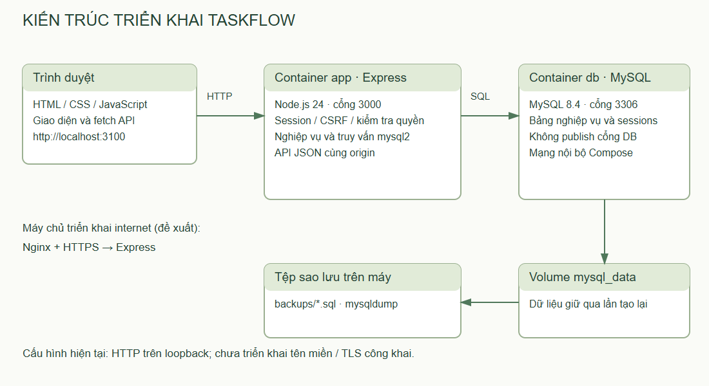
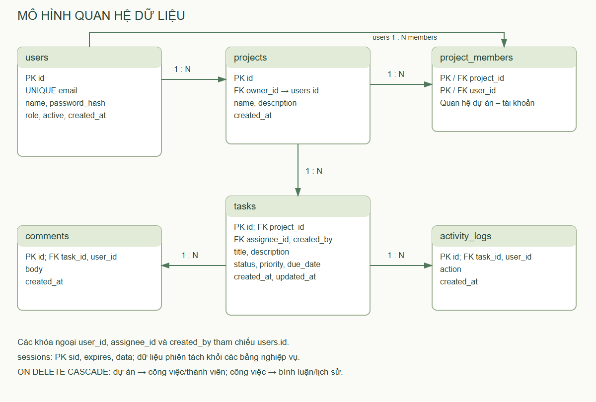
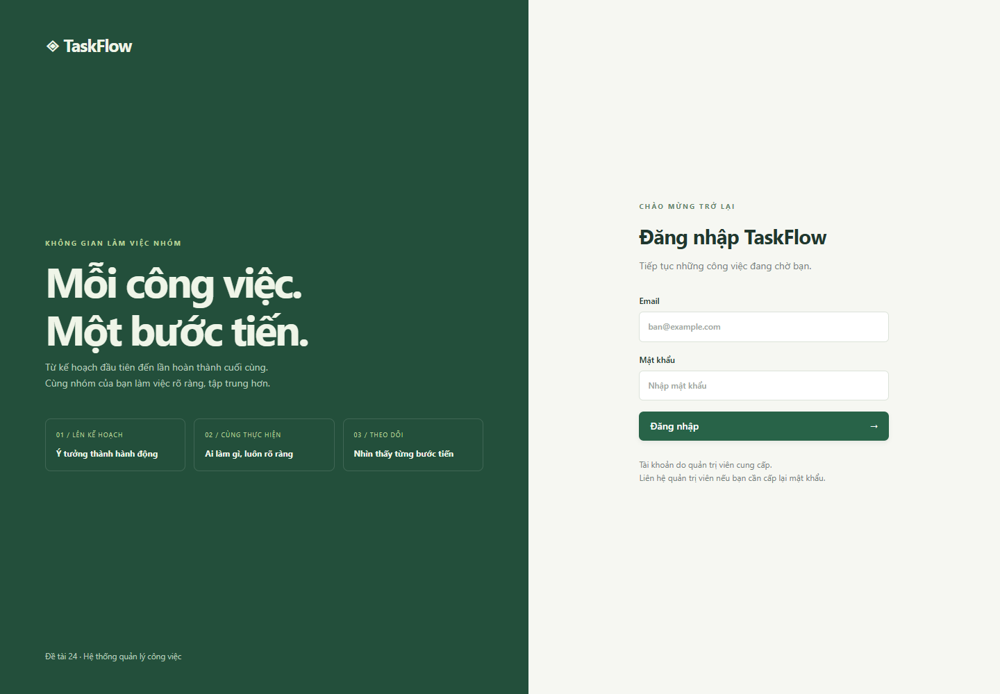
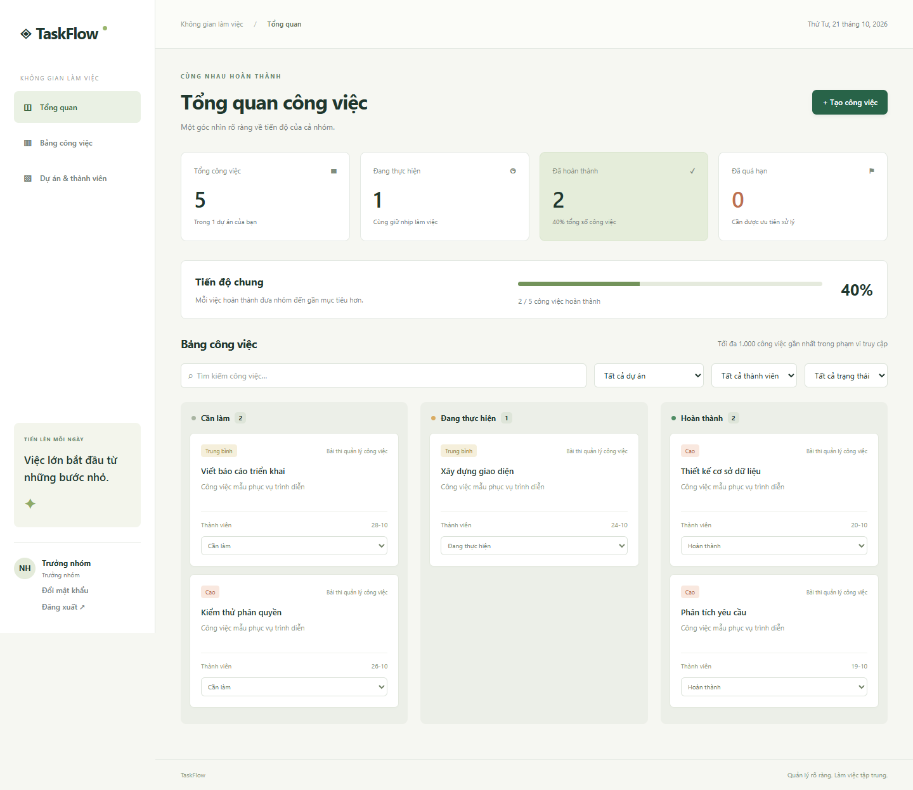
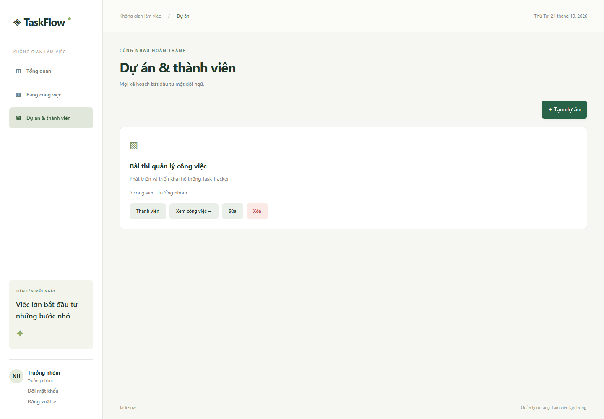
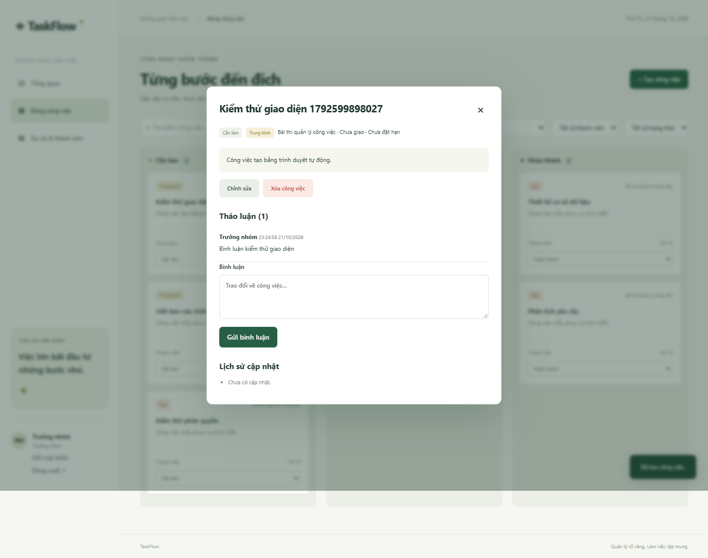
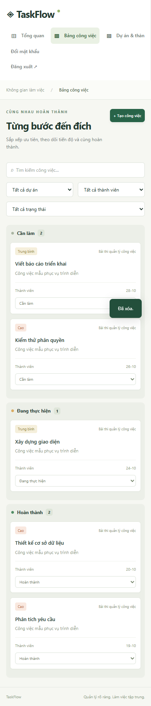
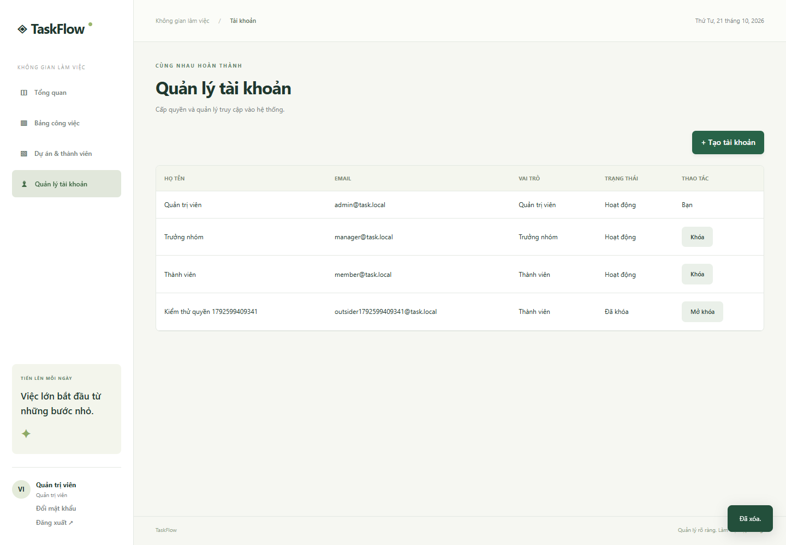

# BÁO CÁO BÀI THI KẾT THÚC HỌC PHẦN

ĐẠI HỌC THÁI NGUYÊN

TRƯỜNG ĐẠI HỌC CÔNG NGHỆ THÔNG TIN VÀ TRUYỀN THÔNG

Học phần: TRIỂN KHAI VÀ QUẢN TRỊ HỆ THỐNG PHẦN MỀM

Đề tài số 24: HỆ THỐNG QUẢN LÝ CÔNG VIỆC / TASK TRACKER

Tên sản phẩm: TASKFLOW

Sinh viên thực hiện: [Điền họ tên]

Mã sinh viên: [Điền mã sinh viên]

Lớp: [Điền lớp]

Giảng viên hướng dẫn: [Điền họ tên giảng viên]

Học kỳ I – Năm học 2026–2027

Thái Nguyên, tháng 10 năm 2026

## Mục lục

1. Mở đầu.
2. Chương 1. Tổng quan đề tài và cơ sở công nghệ.
3. Chương 2. Phân tích yêu cầu và thiết kế hệ thống.
4. Chương 3. Xây dựng ứng dụng.
5. Chương 4. Triển khai và quản trị hệ thống.
6. Chương 5. Kiểm thử và đánh giá.
7. Kết luận và hướng phát triển.
8. Tài liệu tham khảo và phụ lục.

## Mở đầu

Trong học tập và làm việc nhóm, công việc thường được trao đổi qua tin nhắn hoặc bảng tính riêng lẻ. Khi số lượng nhiệm vụ tăng, nhóm khó xác định ai đang phụ trách, thời hạn nào cần ưu tiên và công việc nào đã hoàn thành. Việc cập nhật thiếu thống nhất còn khiến trưởng nhóm phải tổng hợp thủ công để đánh giá tiến độ. Vì vậy, một hệ thống quản lý tập trung có thể hỗ trợ phân công rõ ràng, theo dõi trạng thái và lưu lại trao đổi theo từng nhiệm vụ.

Đề tài xây dựng TaskFlow, ứng dụng web quản lý dự án và công việc cho nhóm quy mô nhỏ. Ngoài các chức năng nghiệp vụ, đề tài tập trung vào khả năng cài đặt lặp lại, quản lý cấu hình, vận hành dịch vụ, kiểm tra nhật ký, sao lưu và phục hồi cơ sở dữ liệu. Đây là những nội dung gắn với học phần Triển khai và quản trị hệ thống phần mềm.

Phương pháp thực hiện gồm xác định tác nhân và quyền hạn; thiết kế dữ liệu quan hệ; xây dựng API và giao diện; đóng gói môi trường bằng Docker Compose; kiểm thử dữ liệu, nghiệp vụ và phân quyền; ghi nhận kết quả từ môi trường thực tế. Báo cáo mô tả phiên bản mã nguồn đi kèm, phân biệt chức năng đã có với nội dung định hướng phát triển. Thông tin cá nhân và giảng viên ở trang bìa cần được bổ sung trước khi nộp.

## Chương 1. Tổng quan đề tài và cơ sở công nghệ

### 1.1. Bài toán và mục tiêu

Hệ thống cần cho phép trưởng nhóm tạo dự án, bổ sung thành viên, chia nhỏ kế hoạch thành công việc và phân công người phụ trách. Mỗi công việc có trạng thái, độ ưu tiên và thời hạn. Thành viên có thể xem nội dung trong dự án tham gia, cập nhật trạng thái việc được giao và bình luận để trao đổi. Quản trị viên quản lý tài khoản và theo dõi dữ liệu toàn hệ thống.

Mục tiêu nghiệp vụ là tập trung dữ liệu công việc và giảm thao tác tổng hợp thủ công. Mục tiêu kỹ thuật là xây dựng ứng dụng có phân quyền phía máy chủ, lưu trữ bền vững trên MySQL, dễ dựng môi trường bằng cấu hình và có quy trình vận hành có thể thực hiện lại. Kết quả được đánh giá bằng các tình huống cụ thể thay vì chỉ dựa trên việc giao diện hiển thị thành công.

### 1.2. Phạm vi thực hiện

Phiên bản hiện tại hỗ trợ đăng nhập, đăng xuất, đổi mật khẩu; tạo và khóa tài khoản; quản lý dự án, thành viên, công việc; tìm kiếm và lọc; bình luận, lịch sử cập nhật; thống kê trạng thái và quá hạn. Quy trình triển khai đi kèm gồm cấu hình môi trường, dựng container, kiểm tra dịch vụ, sao lưu và nhập lại dữ liệu.

Ứng dụng chưa cung cấp email thông báo, email đặt lại mật khẩu, đính kèm tệp, trò chuyện thời gian thực hoặc lịch làm việc nâng cao. Danh sách công việc trả tối đa 1.000 bản ghi mới nhất trong phạm vi truy cập. Các con số trên giao diện tính theo tập dữ liệu này, chưa phải báo cáo phân tích cho tập dữ liệu lớn. Không có số liệu kiểm thử tải hoặc cam kết phục vụ một lượng người dùng cụ thể.

### 1.3. Công nghệ sử dụng

| Thành phần | Công nghệ | Vai trò trong đề tài |
| --- | --- | --- |
| Môi trường chạy | Node.js 24 trong container | Thực thi JavaScript phía máy chủ |
| Framework | Express 5 | Tổ chức middleware và API HTTP |
| Cơ sở dữ liệu | MySQL 8.4, InnoDB | Lưu tài khoản, dự án, công việc và phiên |
| Truy cập dữ liệu | mysql2/promise | Pool kết nối, truy vấn tham số hóa, giao dịch |
| Giao diện | HTML, CSS, JavaScript | Trang tiếng Việt, responsive, gọi API bằng fetch |
| Xác thực | express-session và bảng sessions | Duy trì trạng thái đăng nhập |
| Bảo vệ mật khẩu | bcryptjs | Băm mật khẩu với cost 12 |
| Bảo vệ HTTP | Helmet, rate limit, CSRF token | Header bảo vệ, hạn chế thử mật khẩu, xác minh yêu cầu ghi |
| Đóng gói | Docker, Docker Compose | Tách dịch vụ ứng dụng và cơ sở dữ liệu |
| Kiểm thử | node:test, Playwright với Edge | Kiểm thử dữ liệu, API và giao diện |
| Tài liệu | Markdown, docx | Bản nguồn báo cáo và tệp Word |

Các phiên bản cụ thể được khóa trong package-lock.json; có thể kiểm tra bằng npm ls. Dockerfile dùng npm ci thay vì tự lựa chọn lại phiên bản dependency ở mỗi lần dựng. Đây là cơ sở để tái tạo ứng dụng gần với môi trường đã kiểm tra.

### 1.4. Định hướng bảo mật và vận hành

Tài liệu Express nhấn mạnh việc kiểm tra đầu vào, sử dụng TLS khi truyền dữ liệu nhạy cảm và quản lý các thành phần phần mềm an toàn [1]. Trong phạm vi đề tài, yêu cầu được áp dụng bằng kiểm tra kiểu/độ dài dữ liệu, băm mật khẩu, cookie bảo vệ, truy vấn tham số hóa và cấu hình mẫu reverse proxy. Môi trường chạy tại máy dùng HTTP trên loopback; mẫu HTTPS là hướng dẫn triển khai, chưa phải bằng chứng đã triển khai tên miền công khai.

## Chương 2. Phân tích yêu cầu và thiết kế hệ thống

### 2.1. Tác nhân

Quản trị viên chịu trách nhiệm tạo tài khoản, xác định vai trò ban đầu, khóa hoặc mở khóa tài khoản và quản lý toàn bộ dự án. Trưởng nhóm chịu trách nhiệm quản lý dự án do mình tạo: sửa mô tả, thêm thành viên, tạo và giao việc, điều chỉnh thời hạn, ưu tiên hoặc xóa dữ liệu khi cần. Thành viên thực hiện công việc và trao đổi trong phạm vi dự án được tham gia.

Một trưởng nhóm được thêm vào dự án của người khác có quyền đọc như thành viên, không tự có quyền quản lý dự án đó. Vai trò và quan hệ với dự án là hai điều kiện khác nhau. Quy tắc này ngăn trường hợp một trưởng nhóm truy cập tùy ý công việc của tất cả nhóm.

### 2.2. Yêu cầu chức năng

| Mã | Yêu cầu | Điều kiện chính |
| --- | --- | --- |
| FR01 | Đăng nhập và đăng xuất | Tài khoản đang hoạt động, mật khẩu đúng |
| FR02 | Đổi mật khẩu | Kiểm tra mật khẩu hiện tại; mật khẩu mới ít nhất 10 ký tự |
| FR03 | Tạo, khóa, mở khóa tài khoản | Chỉ quản trị viên; không tự khóa tài khoản đang dùng |
| FR04 | Tạo, sửa, xóa dự án | Quản trị viên hoặc trưởng nhóm sở hữu |
| FR05 | Thêm/xóa thành viên | Tài khoản hợp lệ; không xóa chủ dự án hoặc người đang có việc |
| FR06 | Tạo, sửa, xóa công việc | Người quản lý dự án hợp lệ |
| FR07 | Giao công việc | Người nhận đang hoạt động và thuộc dự án |
| FR08 | Đổi trạng thái | Người quản lý hoặc thành viên được giao việc |
| FR09 | Tìm kiếm và lọc | Chỉ dữ liệu trong phạm vi quyền truy cập |
| FR10 | Bình luận, xem lịch sử | Thành viên dự án hoặc người quản lý có quyền |
| FR11 | Thống kê | Đếm tổng, đang làm, hoàn thành, quá hạn |

### 2.3. Ma trận phân quyền

| Thao tác | Quản trị viên | Trưởng nhóm sở hữu | Thành viên dự án |
| --- | --- | --- | --- |
| Quản lý tài khoản | Có | Không | Không |
| Tạo dự án | Có | Có | Không |
| Sửa/xóa dự án | Mọi dự án | Dự án mình sở hữu | Không |
| Quản lý thành viên | Mọi dự án | Dự án mình sở hữu | Không |
| Tạo/sửa/xóa công việc | Mọi dự án | Dự án mình sở hữu | Không |
| Xem công việc/bình luận | Mọi dự án | Dự án mình sở hữu/tham gia | Dự án tham gia |
| Đổi trạng thái | Mọi công việc | Công việc thuộc dự án sở hữu | Chỉ công việc được giao |

Các quyền trên được thực hiện ở API. Giao diện ẩn nút không phù hợp để giảm nhầm lẫn, nhưng không được sử dụng làm cơ chế phân quyền duy nhất. Khi gọi trực tiếp API, máy chủ vẫn kiểm tra danh tính và tài nguyên yêu cầu.

### 2.4. Quy tắc nghiệp vụ và dữ liệu

Email tài khoản là duy nhất và được chuẩn hóa thành chữ thường khi tạo/đăng nhập. Tên người dùng tối đa 100 ký tự, tên dự án tối đa 150 ký tự, tên công việc tối đa 200 ký tự, mô tả tối đa 5.000 ký tự, bình luận tối đa 2.000 ký tự. Mật khẩu mới tối thiểu 10 ký tự và tối đa 72 byte để phù hợp giới hạn đầu vào bcrypt.

Trạng thái công việc gồm todo, doing và done. Độ ưu tiên gồm low, medium và high. Ngày hạn được kiểm tra định dạng YYYY-MM-DD và tính hợp lệ của ngày, bao gồm năm nhuận. Một việc quá hạn khi có ngày hạn nhỏ hơn ngày hiện tại theo múi giờ Việt Nam và trạng thái chưa hoàn thành. Công việc đến hạn hôm nay chưa được coi là quá hạn.

Khi tạo dự án, hệ thống thêm người tạo vào bảng thành viên trong cùng giao dịch. Khi cập nhật công việc, thay đổi nội dung và ghi lịch sử nằm trong cùng giao dịch. Nếu một câu lệnh thất bại, toàn bộ giao dịch được rollback để tránh trạng thái dữ liệu không nhất quán.

### 2.5. Kiến trúc hệ thống

Ứng dụng sử dụng kiến trúc ba tầng ở mức logic. Tầng trình bày là các tệp trong public, hiển thị giao diện và gửi yêu cầu JSON. Tầng nghiệp vụ là Express, xử lý xác thực, CSRF, phân quyền và dữ liệu. Tầng lưu trữ là MySQL với các bảng quan hệ. Giao diện và API cùng origin nên không cần mở CORS cho miền khác.

Sơ đồ triển khai: Trình duyệt → HTTP localhost:3100 → container app:3000 → mạng nội bộ Docker → container db:3306 → volume mysql_data. Khi triển khai internet, thêm Nginx và TLS phía trước Express. Cổng MySQL không được công bố ra máy chủ trong cấu hình Compose hiện tại.

### 2.6. Thiết kế cơ sở dữ liệu

| Bảng | Thuộc tính chính | Ý nghĩa |
| --- | --- | --- |
| users | id, name, email, password_hash, role, active | Tài khoản và quyền hệ thống |
| projects | id, name, description, owner_id | Dự án và người sở hữu |
| project_members | project_id, user_id | Quan hệ nhiều–nhiều giữa dự án và tài khoản |
| tasks | id, project_id, title, description, assignee_id, status, priority, due_date, created_by | Nhiệm vụ và thông tin phân công |
| comments | id, task_id, user_id, body, created_at | Trao đổi theo công việc |
| activity_logs | id, task_id, user_id, action, created_at | Lịch sử cập nhật công việc |
| sessions | sid, expires, data | Phiên đăng nhập và thời điểm hết hạn |

Một người dùng sở hữu nhiều dự án; dự án có nhiều thành viên thông qua project_members. Một dự án có nhiều công việc; công việc có thể chưa được giao hoặc gán cho một tài khoản. Mỗi công việc có nhiều bình luận và bản ghi lịch sử. Khóa chính ghép của project_members ngăn thêm trùng một thành viên vào cùng dự án.

Khóa ngoại bảo đảm công việc thuộc dự án tồn tại và bình luận thuộc công việc tồn tại. Xóa dự án kéo theo xóa công việc, thành viên và dữ liệu bình luận/lịch sử liên quan bằng ON DELETE CASCADE. Tài khoản được khóa thay vì xóa để giữ quan hệ và thông tin tác giả. Các chỉ mục trên project_id/status, assignee_id, due_date hỗ trợ các truy vấn nghiệp vụ; hiệu quả với dữ liệu lớn chưa được đo bằng kiểm thử tải.

### 2.7. Đặc tả ca sử dụng tiêu biểu

**UC01 – Đăng nhập:** người dùng mở trang và nhập email/mật khẩu. Trình duyệt đã nhận CSRF token từ API session. Máy chủ tra tài khoản, kiểm tra active và đối chiếu bcrypt. Nếu hợp lệ, hệ thống tạo lại mã phiên để tránh tái sử dụng phiên trước đăng nhập, lưu userId và trả thông tin người dùng. Nếu sai, trả thông báo chung và không tạo phiên đã xác thực.

**UC02 – Giao việc:** trưởng nhóm chọn dự án sở hữu, nhập tiêu đề, mô tả, ưu tiên, ngày hạn và người nhận. Máy chủ kiểm tra quyền quản lý, dữ liệu và quan hệ thành viên của người nhận trước khi tạo bản ghi. Trường hợp người nhận không thuộc dự án hoặc đã bị khóa sẽ bị từ chối.

**UC03 – Cập nhật trạng thái:** thành viên chọn công việc được giao và trạng thái mới. API chỉ chấp nhận trường status với tác nhân này; yêu cầu kèm tiêu đề hoặc nội dung khác bị từ chối. Sau cập nhật, hệ thống ghi lịch sử người thực hiện và trạng thái trước/sau. Người ngoài dự án không đọc hoặc cập nhật được công việc.

**UC04 – Sao lưu:** người vận hành chạy tiện ích backup. Script gọi mysqldump trong container database và lưu tệp SQL vào thư mục backups ở máy chủ. Nếu lệnh xuất lỗi, script báo thất bại và không thông báo đã sao lưu thành công.

## Chương 3. Xây dựng ứng dụng

### 3.1. Tổ chức mã nguồn

Tệp src/app.js tạo ứng dụng Express và đăng ký middleware/API. Tệp src/server.js kiểm tra khóa phiên, mở store và lắng nghe cổng. Tệp src/db.js quản lý pool kết nối và múi giờ của kết nối. Tệp src/session-store.js triển khai Store API của express-session bằng mysql2; không dùng bộ nhớ tiến trình làm nơi lưu phiên chính. Tệp src/validation.js tập trung kiểm tra định danh, chuỗi, lựa chọn và ngày.

Thư mục public chứa trang HTML, stylesheet và JavaScript xử lý sự kiện. Database/schema.sql khai báo các bảng nghiệp vụ. Scripts/init-db.js áp dụng các câu CREATE TABLE IF NOT EXISTS và thêm dữ liệu mẫu khi chưa có người dùng. Thư mục test chứa kiểm thử đơn vị và tích hợp; scripts/browser-check.js thực hiện thao tác trình duyệt và lưu ảnh.

### 3.2. Luồng xử lý API

Mỗi yêu cầu đi qua Helmet, bộ phân tích JSON và session middleware. Yêu cầu ghi dữ liệu được đối chiếu CSRF token. Sau đăng nhập, các API riêng tư tải lại tài khoản từ cơ sở dữ liệu và yêu cầu active=1. Do đó, khóa tài khoản có hiệu lực ngay với phiên đã đăng nhập ở yêu cầu tiếp theo.

Trước khi truy cập dự án, hàm projectAccess xác định bản ghi tồn tại, quyền quản trị hoặc quyền sở hữu/thành viên. Với công việc, hệ thống tải bản ghi rồi kiểm tra dự án tương ứng. Việc kiểm tra theo tài nguyên ngăn người dùng chỉ cần thay ID trên URL để đọc hoặc sửa dữ liệu nhóm khác.

### 3.3. Các nhóm API chính

| Nhóm | Ví dụ | Chức năng |
| --- | --- | --- |
| Trạng thái/xác thực | GET /api/health, GET /api/session, POST /api/login | Kiểm tra DB, lấy phiên, đăng nhập |
| Tài khoản | GET/POST /api/users, PATCH /api/users/:id | Danh sách, tạo, khóa/mở khóa |
| Dự án | GET/POST /api/projects, PATCH/DELETE /api/projects/:id | Quản lý dự án |
| Thành viên | GET/POST /api/projects/:id/members | Xem/thêm thành viên |
| Công việc | GET/POST /api/tasks, PATCH/DELETE /api/tasks/:id | Truy vấn, tạo và cập nhật công việc |
| Trao đổi | GET /api/tasks/:id/discussion, POST /api/tasks/:id/comments | Bình luận và lịch sử |
| Mật khẩu/phiên | POST /api/password, POST /api/logout | Đổi mật khẩu, kết thúc phiên |

Các lỗi đầu vào trả HTTP 400, chưa đăng nhập trả 401, thiếu quyền trả 403, không tìm thấy trả 404, xung đột dữ liệu trả 409. Lỗi máy chủ trả thông báo chung và ghi mã lỗi vào console; không đưa câu SQL, password_hash hoặc bí mật cấu hình vào thông báo API.

### 3.4. Xây dựng giao diện

Giao diện sử dụng bảng màu xanh lá và nền sáng, thanh điều hướng bên trái, khu vực tổng quan và bảng công việc. Bốn chỉ số gồm tổng công việc, đang thực hiện, hoàn thành và quá hạn. Bộ lọc kết hợp dự án, người phụ trách, trạng thái và từ khóa. Công việc được chia ba cột; trạng thái có thể thay đổi trực tiếp bằng danh sách lựa chọn nếu người dùng có quyền.

Hộp thoại tạo công việc tự tải thành viên theo dự án đang chọn. Giao diện chi tiết hiển thị nội dung, thông tin phân công, bình luận và lịch sử. Trang dự án cho phép quản lý thành viên theo email; trang tài khoản dành cho quản trị viên. Trên màn hình nhỏ, thanh điều hướng chuyển thành hàng và các cột công việc xếp dọc.

### 3.5. Biện pháp bảo vệ dữ liệu

Mật khẩu được băm bằng bcrypt trước khi ghi users. SQL dùng placeholder cho dữ liệu đầu vào. Khi hiển thị nội dung người dùng, frontend mã hóa các ký tự HTML đặc biệt để tránh diễn giải tiêu đề, mô tả hoặc bình luận như mã HTML. Các yêu cầu thay đổi dữ liệu dùng CSRF token gắn với phiên và so sánh bằng timingSafeEqual khi độ dài hợp lệ.

Cookie sử dụng HttpOnly và SameSite=Lax. Mã phiên được tạo lại khi đăng nhập và xóa khi đăng xuất. Dữ liệu phiên lưu trong MySQL, có thời điểm hết hạn và tác vụ dọn định kỳ 15 phút. API đăng nhập giới hạn 20 lần mỗi 15 phút theo IP trên một tiến trình. Đây là cấu hình cho một instance; nếu mở rộng nhiều instance cần store rate-limit dùng chung và cơ chế vận hành tương ứng.

## Chương 4. Triển khai và quản trị hệ thống

### 4.1. Môi trường triển khai thực tế

Mã nguồn được thực hiện trên Windows với PowerShell, Node.js v24.21.0 và Docker Engine 26.1.4 qua Docker Desktop. Ứng dụng đóng gói bằng image node:24-alpine, cơ sở dữ liệu dùng mysql:8.4. Hai dịch vụ nằm trong mạng Compose riêng; MySQL dùng named volume để duy trì dữ liệu khi container được tạo lại.

Cổng 3000 trên máy đã được ứng dụng khác sử dụng, vì vậy cấu hình thực tế chọn PORT=3100. Docker ánh xạ 127.0.0.1:3100 vào app:3000. Không dừng hoặc thay đổi ứng dụng đang dùng cổng 3000. Địa chỉ trình diễn là http://localhost:3100. Chưa triển khai dịch vụ ra internet hoặc cài chứng chỉ TLS thực tế.

### 4.2. Quản lý cấu hình

Tệp .env.example mô tả các biến cần có; scripts/configure.js sinh tệp .env với bí mật ngẫu nhiên nếu tệp chưa tồn tại. Các biến gồm PORT, DB_HOST, DB_PORT, DB_NAME, DB_USER, DB_PASSWORD, SESSION_SECRET, SEED_PASSWORD và MYSQL_ROOT_PASSWORD. Tệp .env được loại khỏi Git và Docker build context.

SESSION_SECRET phải có ít nhất 32 ký tự và không để giá trị mẫu. SEED_PASSWORD chỉ dùng lúc tạo dữ liệu mẫu; thay biến này không cập nhật mật khẩu đã lưu. Cần đổi mật khẩu các tài khoản mẫu khi chuyển sang sử dụng thực tế. Tài khoản ứng dụng không dùng root; root chỉ phục vụ quản trị database container.

### 4.3. Quy trình cài đặt

1. Cài Docker Desktop và mở dịch vụ Linux containers; kiểm tra docker info hoạt động.
2. Mở terminal tại thư mục mã nguồn, chạy node scripts/configure.js.
3. Kiểm tra PORT trong .env, đổi nếu bị trùng cổng.
4. Chạy docker compose up -d --build.
5. Kiểm tra docker compose ps; database phải healthy, app phải Up.
6. Mở địa chỉ localhost theo PORT và đăng nhập bằng tài khoản mẫu.
7. Gọi /api/health để xác minh Express kết nối được MySQL.

Dockerfile cài dependency bằng npm ci --omit=dev và chạy bằng user node. Compose chờ healthcheck database trước khi khởi động app; thứ tự và điều kiện service_healthy tuân theo cơ chế phụ thuộc được mô tả trong tài liệu Docker [3]. Khi app khởi động, script init-db tạo cấu trúc và dữ liệu ban đầu trước khi chạy server. Phiên bản này chưa có hệ thống migration cho các thay đổi schema phức tạp.

### 4.4. Quản lý dịch vụ và nhật ký

| Nhiệm vụ | Lệnh |
| --- | --- |
| Xem trạng thái | docker compose ps |
| Xem lỗi ứng dụng | docker compose logs --tail 100 app |
| Xem MySQL | docker compose logs --tail 100 db |
| Khởi động lại app | docker compose restart app |
| Tạm dừng hệ thống | docker compose stop |
| Khởi động lại hệ thống | docker compose start |
| Áp dụng mã mới | docker compose up -d --build |

Nhật ký hiện ghi ra stdout/stderr để Docker thu thập. Lỗi server có thời điểm, phương thức, đường dẫn và mã lỗi; không ghi nội dung mật khẩu. Người vận hành cần kiểm tra dung lượng log và cấu hình luân chuyển khi sử dụng dài hạn. Hệ thống chưa tích hợp nền tảng giám sát tập trung hoặc cảnh báo tự động.

### 4.5. Sao lưu cơ sở dữ liệu

Tiện ích node scripts/backup.js chạy mysqldump trong container database, sử dụng --single-transaction cho bảng InnoDB, --no-tablespaces và --set-gtid-purged=OFF. Dữ liệu xuất được ghi trực tiếp từ Buffer sang tệp SQL để giữ tiếng Việt, tránh chuyển mã khi dùng toán tử chuyển hướng của một số phiên bản PowerShell. Cách sử dụng mysqldump dựa trên tài liệu MySQL [2].

Tệp sao lưu có thời gian trong tên và nằm trong backups, ngoài volume database. Một bản sao cùng máy vẫn có nguy cơ mất khi ổ đĩa hỏng; khi vận hành thật cần thêm nơi lưu độc lập và kiểm soát quyền đọc vì tệp chứa dữ liệu tài khoản cùng password_hash. Đề xuất sao lưu hàng ngày, giữ ít nhất 7 bản gần nhất và thử phục hồi định kỳ; lịch tự động này chưa được cấu hình trong bản thực hành.

### 4.6. Phục hồi và xác minh

Lệnh node scripts/restore.js backups/<ten-file>.sql --confirm chỉ nhận tệp SQL bên trong thư mục backups. Script dừng app trước khi nhập dữ liệu, sử dụng mysql client của container rồi khởi động app lại. Dừng ghi ứng dụng giúp tránh trộn dữ liệu trong lúc phục hồi; thao tác nhập SQL không phải giao dịch nguyên tử cho toàn bộ bản dump nên cần kiểm tra mã thoát và kết quả sau khi hoàn tất.

Trước phục hồi phải tạo bản sao hiện trạng, xác định đúng database và khoảng thời gian dữ liệu cần quay lại. Sau phục hồi, kiểm tra health, đăng nhập, số bản ghi dự án/công việc và dữ liệu tiếng Việt. Không sử dụng down -v trong quy trình thường ngày vì tùy chọn này xóa volume chứa database.

### 4.7. Quy trình cập nhật và quay lui

Trước cập nhật, giữ mã nguồn hoặc image phiên bản đang chạy và tạo bản sao database. Kiểm thử bản mới trên môi trường riêng, sau đó dựng lại app, theo dõi nhật ký và chạy smoke test. Nếu app lỗi nhưng schema chưa thay đổi, quay về mã cũ và dựng lại. Nếu thay đổi cấu trúc dữ liệu, phải đánh giá tính tương thích trước khi quay lui và xác định khả năng mất các thay đổi phát sinh sau bản sao.

Phiên bản hiện tại dùng CREATE TABLE IF NOT EXISTS cho khởi tạo, không tự nâng cấp cột đã có. Vì vậy các lần phát triển tiếp theo cần bổ sung migration có phiên bản, kèm hướng rollback rõ ràng; không coi việc chạy lại init-db là giải pháp nâng cấp schema tổng quát.

### 4.8. Triển khai HTTPS và xử lý sự cố

Tệp deploy/nginx.conf là mẫu cho máy chủ có tên miền và chứng chỉ. Khi sử dụng cần thay đường dẫn chứng chỉ, proxy đến cổng thực tế, đặt COOKIE_SECURE=true và chỉ bật TRUST_PROXY=true khi app nằm sau một reverse proxy tin cậy. Cấu hình Compose hiện đặt false cho hai biến này để sử dụng HTTP localhost; cần sửa ở environment của service app khi chuyển môi trường.

| Hiện tượng | Nguyên nhân có thể | Hướng xử lý |
| --- | --- | --- |
| Không kết nối Docker | Docker Desktop chưa chạy hoặc quyền bị chặn | Mở Docker, kiểm tra docker info và quyền truy cập |
| Address already in use | Cổng máy chủ đang bị chiếm | Đổi PORT, chạy lại compose up -d |
| App lỗi kết nối MySQL | DB chưa sẵn sàng, sai biến môi trường | Xem health/log db, đối chiếu DB_* |
| Đổi mật khẩu DB nhưng app lỗi | Volume cũ vẫn giữ tài khoản/mật khẩu trước | Cập nhật mật khẩu bằng SQL theo quy trình quản trị; không xóa volume tùy tiện |
| Đăng nhập không được | Sai mật khẩu, tài khoản khóa, cookie không phù hợp | Kiểm tra trạng thái, SEED_PASSWORD ban đầu, cấu hình HTTPS/Secure |
| npm.ps1 bị PowerShell chặn | ExecutionPolicy của máy | Dùng npm.cmd thay cho npm |
| Tiếng Việt lỗi sau nhập dữ liệu | Sai charset hoặc chuyển mã tệp | Dùng utf8mb4 và script backup/restore đi kèm |

## Chương 5. Kiểm thử và đánh giá

### 5.1. Phương pháp kiểm thử

Kiểm thử dữ liệu gọi trực tiếp các hàm kiểm tra định danh, ngày và chuỗi. Kiểm thử tích hợp gửi HTTP đến Express đang chạy và sử dụng MySQL thật qua container. Tài khoản mẫu admin, manager, member được dùng để kiểm tra vai trò; một tài khoản ngoài dự án được tạo cho tình huống truy cập trái quyền và khóa sau khi kiểm thử. Dự án kiểm thử được xóa khi kết thúc.

Kiểm thử trình duyệt sử dụng Edge ở chế độ headless với Playwright, kích thước desktop 1440×1000 và mobile 390×844. Ảnh trong chương 3 được chụp từ phiên chạy ứng dụng, không phải thiết kế mô phỏng. Kết quả kiểm thử API không thay thế đánh giá tải, kiểm thử xâm nhập hoặc đánh giá trải nghiệm với nhiều người dùng.

### 5.2. Các tình huống API và dữ liệu

| Mã | Nội dung kiểm tra | Kết quả mong đợi |
| --- | --- | --- |
| TC01 | Chưa đăng nhập đọc công việc | HTTP 401 |
| TC02 | POST thiếu CSRF token | HTTP 403 |
| TC03 | Sai mật khẩu | HTTP 401, không có phiên xác thực |
| TC04 | Thành viên đọc danh sách tài khoản | HTTP 403 |
| TC05 | Thành viên tạo dự án | HTTP 403 |
| TC06 | Admin tạo tài khoản | HTTP 201 |
| TC07 | Manager tạo dự án | HTTP 201 |
| TC08 | Người ngoài đọc thành viên dự án | HTTP 403 và không thấy dự án trong danh sách |
| TC09 | Giao việc cho người ngoài dự án | HTTP 400 |
| TC10 | Thêm thành viên rồi tạo việc hợp lệ | HTTP 201 |
| TC11 | Người được giao đổi trạng thái | HTTP 200 và có lịch sử |
| TC12 | Thành viên sửa tiêu đề hoặc xóa việc | HTTP 403 |
| TC13 | Người ngoài đọc/bình luận công việc | HTTP 403 |
| TC14 | Lưu và đọc bình luận tiếng Việt | Nội dung khớp chính xác |
| TC15 | Lọc dự án, trạng thái, từ khóa | Chỉ trả công việc phù hợp |
| TC16 | Ngày 2026-02-30 | HTTP 400 |
| TC17 | Xóa thành viên đang có việc | HTTP 409 |
| TC18 | Khóa tài khoản có phiên đăng nhập | Yêu cầu tiếp theo HTTP 401 |
| TC19 | Đăng xuất rồi truy cập công việc | HTTP 401 |
| UT01 | ID âm, số lẻ, chuỗi chèn lệnh | Hàm kiểm tra từ chối |
| UT02 | Ngày sai và năm nhuận | Từ chối ngày sai, chấp nhận 2028-02-29 |
| UT03 | Chuỗi rỗng, vượt độ dài, sai enum | Hàm kiểm tra từ chối |

Lần chạy tích hợp đã đạt 19 tình huống con và 3 kiểm thử đơn vị. Bộ chạy Node báo 23 pass, tính cả một mục kiểm thử cha; không có lỗi và không có trường hợp bỏ qua trong lần bật RUN_INTEGRATION=true. Kiểm tra cú pháp máy chủ và JavaScript giao diện cũng đạt. Bằng chứng tóm tắt được lưu trong docs/ket-qua-kiem-thu.md.

### 5.3. Kiểm thử giao diện và vận hành

Phần kiểm thử giao diện kiểm tra đăng nhập hai vai trò, hiển thị tổng quan/ba cột, mở dự án, tạo công việc, bình luận, xóa công việc kiểm thử, bố cục màn hình nhỏ và quản lý tài khoản. Kết quả cuối cùng, ảnh chụp và các giới hạn xác minh được ghi trong tài liệu kết quả kiểm thử đi kèm, cùng tệp browser-result.json khi chạy thành công.

Kết quả thực tế: 8 nhóm kiểm tra trình duyệt đạt, không có lỗi JavaScript pageerror; bố cục 390×844 không tràn ngang. Thử phục hồi thành công với 1 dự án và 5 công việc trước/sau. Bản ghi đánh dấu thêm sau sao lưu đã được loại bỏ sau phục hồi; tiêu đề tiếng Việt và trạng thái khớp, đăng nhập sau phục hồi thành công. Kết quả chi tiết nằm ở restore-result.json.

Đối với vận hành, cần ghi nhận container database healthy, app Up, health API thành công, tạo bản sao SQL và nhập lại bản sao trước khi khẳng định phục hồi đạt. Các bước này được kiểm tra riêng với dữ liệu thực hành. Không suy diễn rằng sao lưu thành công đồng nghĩa dữ liệu chắc chắn phục hồi được nếu chưa thử nhập lại và đối chiếu.

### 5.4. Đánh giá kết quả

Các chức năng cốt lõi phù hợp bài toán nhóm nhỏ và có kiểm tra quyền từ máy chủ. Việc khóa tài khoản được kiểm tra ở mỗi yêu cầu, không chỉ lúc đăng nhập. Khởi tạo và đóng gói giúp giảm số bước cài đặt thủ công. Tệp cấu hình mẫu, hướng dẫn và tiện ích quản trị tạo điều kiện cho người khác dựng lại hệ thống.

Kiểm tra npm tại thời điểm hoàn thiện dependency báo không có lỗ hổng đã biết trong tập thư viện cài đặt. Kết quả này chỉ phản ánh cơ sở dữ liệu cảnh báo của npm tại thời điểm kiểm tra; không chứng minh toàn bộ ứng dụng không còn lỗi bảo mật. Cần tiếp tục theo dõi dependency và đánh giá trước khi đưa vào môi trường công khai.

Hạn chế còn lại gồm giới hạn 1.000 công việc, chưa có phân trang đầy đủ, chưa có kiểm thử tải, chưa đo phục hồi với dữ liệu lớn, chưa có quản lý phiên thiết bị và chức năng quên mật khẩu. Hoạt động xóa không có thùng rác; cần sao lưu và xác nhận trước khi xóa. Nhật ký thay đổi công việc hiện lưu tóm tắt, chưa phải hệ thống audit bất biến và sẽ bị xóa cùng công việc.

## Kết luận và hướng phát triển

Đề tài đã xây dựng TaskFlow trên nền tảng Node.js Express và MySQL, đáp ứng chu trình từ tạo dự án, giao việc đến theo dõi trạng thái và trao đổi. Phần triển khai cung cấp Docker Compose, cấu hình riêng môi trường, lưu trữ bằng volume và công cụ sao lưu/phục hồi. Kiểm thử tập trung vào các quy tắc quyền truy cập và tính hợp lệ của dữ liệu để hỗ trợ đánh giá hệ thống thực tế.

Trong giai đoạn tiếp theo có thể bổ sung phân trang và thống kê phía máy chủ, thông báo email, chức năng đặt lại mật khẩu an toàn, tệp đính kèm, migration dữ liệu, log tập trung và cảnh báo vận hành. Khi mở rộng phạm vi sử dụng cần kiểm thử tải, triển khai HTTPS thực tế và kiểm tra khôi phục dữ liệu trên một môi trường độc lập.

## Tài liệu tham khảo

[1] Express.js. Production Best Practices: Security. https://expressjs.com/en/advanced/best-practice-security/ . Truy cập ngày 21/10/2026.

[2] Oracle MySQL. MySQL 8.4 Reference Manual – mysqldump, A Database Backup Program. https://dev.mysql.com/doc/refman/8.4/en/mysqldump.html . Truy cập ngày 21/10/2026.

[3] Docker Documentation. Control startup and shutdown order in Compose. https://docs.docker.com/compose/how-tos/startup-order/ . Truy cập ngày 21/10/2026.

## Phụ lục A. Hướng dẫn sử dụng ngắn

Quản trị viên đăng nhập bằng tài khoản được cấp, mở Quản lý tài khoản và tạo tài khoản mới với email duy nhất, mật khẩu hợp lệ và vai trò phù hợp. Khi nhân sự ngừng tham gia, khóa tài khoản để dừng truy cập nhưng vẫn giữ các quan hệ dữ liệu.

Trưởng nhóm vào Dự án & thành viên, tạo dự án và thêm người tham gia bằng email. Trong Bảng công việc chọn Tạo công việc, nhập thông tin và chọn người nhận. Theo dõi các cột trạng thái, dùng bộ lọc để tìm việc theo dự án hoặc người phụ trách; mở chi tiết để xem bình luận và lịch sử.

Thành viên đăng nhập, mở việc được giao và thay đổi trạng thái khi bắt đầu hoặc hoàn thành. Khi có vấn đề cần trao đổi, thêm bình luận trong chi tiết công việc. Không chia sẻ mật khẩu mẫu ra bên ngoài và sử dụng chức năng Đổi mật khẩu để thay mật khẩu ban đầu.

## Phụ lục B. Danh mục sản phẩm

- Mã nguồn Express/MySQL và giao diện HTML/CSS/JavaScript.
- Schema SQL, dữ liệu mẫu sinh bằng script.
- Dockerfile, compose.yaml, cấu hình mẫu Nginx.
- Tiện ích sinh cấu hình, sao lưu và phục hồi.
- Bộ kiểm thử dữ liệu, API, trình duyệt; ảnh giao diện thực tế.
- README cài đặt/vận hành, báo cáo Markdown/Word, kịch bản bảo vệ.

## Phụ lục C. Lưu ý trước khi nộp

Điền họ tên, mã sinh viên, lớp và giảng viên; đối chiếu lại tên học phần với yêu cầu chính thức. Đọc mã nguồn và thực hành theo kịch bản bảo vệ để giải thích được các quy tắc phân quyền, quan hệ dữ liệu và thao tác vận hành. Nếu giảng viên có mẫu định dạng riêng, điều chỉnh trang bìa, mục lục và cách trình bày theo mẫu đó. Không đưa .env hoặc mật khẩu thật vào tệp nộp công khai.
